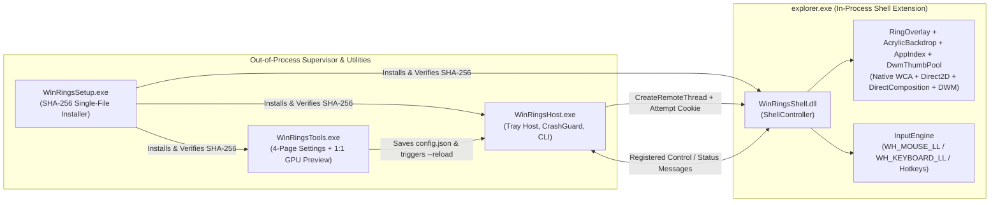

# WinRings-Custom (`v3.0.5.0`) — Unified Windows 11 Radial Switcher, Top Minimal Bar & Media Island

[](https://github.com/Akramx15/WinRings-Custom)
[](https://github.com/Akramx15/WinRings-Custom)
[](https://github.com/Akramx15/WinRings-Custom)
[](https://github.com/AhmadotEng/WinRings/releases/tag/v3.0.0)
[](LICENSE)

**WinRings-Custom** is Akram's pure native **C++17 (`x64`, static `/MT` CRT, zero `.NET`/CLR)** fork of **[AhmadotEng/WinRings](https://github.com/AhmadotEng/WinRings)** (`v3.0.0` core). It combines upstream's lightweight Direct2D + DirectComposition radial switcher (`WCA` native A4S-Menu acrylic, 3D glass bevel edges, click-vs-drag `Downloads` folder fan-out with OLE drag-out, drag-to-reorder pins) with a unified in-process **Minimal Top Bar**, **FullWorkArea**, **Dynamic Media Island**, **Win-Key / Direct Switch (`Alt+F`) / Touchpad & `WH_MOUSE_LL` 2D Mouse Shake gestures**, **Drag-to-Snap split-screen**, and quick window management actions.

For AI coding assistants & maintainers, see **[AGENTS.md](AGENTS.md)**, **[CLAUDE.md](CLAUDE.md)**, and **[.github/copilot-instructions.md](.github/copilot-instructions.md)**.

---

## What's Added in WinRings-Custom (`v3.0.5.0`)

- **Unified Minimal Top Bar (`TopBarHook` + `XamlTaskbarCtrl` + `ClockFormat.h`):** Docks the Windows 11 taskbar cleanly to the top edge (`28–40 DIP`), hides cluttered elements while keeping the native System Tray, formats a compact single-line clock, exposes live `SystemTrayFrame.ActualWidth()`, and keeps a synchronous `Shell_TrayWnd` `WM_WINDOWPOSCHANGING` top-lock + `0 ms` wake/display/unlock resync to eliminate Sleep/Wake bottom-edge flashes.
- **FullWorkArea Integration (`FullWorkAreaCtrl`):** Extends maximized windows behind the minimal top bar on Windows 11 26H2 (`26300+`) with immediate wake recovery.
- **Dynamic Media Island (`MediaIsland`):** GSMTC now-playing pill inside the top bar with hover expand card, dynamic tray-avoidance & proportional shrink, `Alt + Drag` custom horizontal placement, right-click menu + `Show Media Island` tray/ring toggle, Z-order fullscreen detection (`SyncWithTaskbar` / `GamesOnly` / `NeverHide`), immediate wake re-anchor, and scroll-wheel master volume control (mice, `WM_POINTERWHEEL`, top screen edge `y=0..barPx`, and `ELAN06FA` 2-finger HID).
- **Resilient `WH_MOUSE_LL` 2D Mouse Shake, GNOME Hot Corner, Win Key & Precision Touchpad (`InputEngine` + `GestureEngine` + `ShellController`):** Post-heavy-init hook installation + UIPI-aware watchdog cursor-heartbeat recovery against boot hook eviction, PTP `LLMHF_INJECTED`-safe 2D shake detection, `ELAN06FA` serial multi-contact HID corner tap with `350 ms` idle recovery, optional Win-key replacement, and `Alt+F`/`Win+F`/`Alt+Q` Direct Window Switch.
- **Drag-to-Snap Split-Screen & Ring UX (`WindowSnapCtrl` + `RingOverlay` + `SlotModel`):** Drag window cards or tear-off ring slots with lightweight real-time live window movement (`60Hz` `SWP_ASYNCWINDOWPOS`), Fluent edge preview, pixel-perfect **Direct Snap** with immediate foreground focus (`DWMWA_EXTENDED_FRAME_BOUNDS` compensated, or optional `dragToSnapUseSnapAssist` for `Win+Arrow` Snap Assist), closed-app launch & snap, window card `X` close button, right-click **`Open`**, **`Run as Administrator`**, **`Open File Location`**, and **`Pin to Ring` / `Unpin from Ring`** directly on **Search Arc** results (`.lnk` & UWP-aware) as well as main ring slots, **End Task**, `SelectionIndicatorStyle`, and `disableRingBlur`.

See **[docs/CUSTOM_FEATURES.md](docs/CUSTOM_FEATURES.md)** and **[docs/KNOWN_ISSUES.md](docs/KNOWN_ISSUES.md)** for complete details.

---

## Table of Contents

- [Key Features](#key-features)
- [System Architecture](#system-architecture)
- [Quick Start & Installation](#quick-start--installation)
- [How to Trigger & Use the Ring](#how-to-trigger--use-the-ring)
- [CLI Reference](#cli-reference)
- [Configuration (`config.json`)](#configuration-configjson)
- [Building & Testing from Source](#building--testing-from-source)
- [Documentation Index](#documentation-index)
- [Project Lineage](#project-lineage)
- [License](#license)

---

## Key Features

### 1. Radial Switcher (`RingOverlay`, `AcrylicBackdrop`, `RingThemeEngine`, `AppIndex`, `DwmThumbPool`, `InputEngine`)
- **Approved Native A4S-Menu Frosted Acrylic & 3D Beveled Glass Edges (`RingOverlay` + `RingThemeEngine`):**
  - **Exact Native A4S-Menu Backdrop:** Uses a synchronized click-through backdrop window (`WinRings.WcaBackdrop.v1`) running Windows 11's native `SetWindowCompositionAttribute(WCA_ACCENT_POLICY, ACCENT_ENABLE_ACRYLICBLURBEHIND, state = 4, flags = 0x13, 0x80202020)` with `BeginBufferedPaint(BPPF_ERASE)` and hash-gated `SetWindowRgn` (`RGN_DIFF` hollow annulus, curved outer arcs, and rounded pills) — delivering the exact same DWM acrylic texture, blur, luminosity, and glow as A4S-Menu, with automatic fallback to `Windows::UI::Composition` (`AcrylicBackdrop`).
  - **Smooth 3D Glass Bevel Rims:** Layered directly beneath the antialiased Direct2D + DirectComposition foreground overlay (`WinRings.Overlay.v1`), which bridges the `1.0 px` inset region boundary with a `2.0 DIP` antialiased edge-bridge, a subtle top-lit 3D outer glass bezel gradient, an optically recessed 3D inner bevel gradient, and a soft elevation shadow lip.
  - **3 Visual Style Presets:** **`A4S`** (default A4S-Menu live wallpaper-reactive frosted acrylic), **`DarkWood`** (matte `#202020` dark surface), and **`Blue`** (`#3186FF` sapphire glass), paired with continuous **Glass Level (`0–100%`)** and **Light / Dark Mode (`0–100%`)** sliders.
  - **True Annulus Geometry:** Clean open center ring (`holeRadius = 60 DIP`, `outerRadius = 148 DIP`, `ringRadius = 112 DIP`, `iconSize = 42 DIP`) with no shaded center disc or cone wedge overlay.
- **Frame-0 Instant Response:** Opens at full scale on frame 0 (`disableOpeningAnimation = true` by default) and respects Windows `SPI_GETCLIENTAREAANIMATION`.
- **Bounded Annulus + Cone Hit-Testing (`18 DIP` Deadzone):** Tight `18 DIP` inner deadzone (`ringDeadzoneDip = 18.0`) with strictly bounded main-ring hover detection (`dist <= outerRadius + 14 DIP`) so moving into empty outer space never triggers unexpanded slots, while active outer submenus remain reachable through their angular hover corridor.
- **System-Wide App Search & Top Half-Ring (`AppIndex` + `SearchMatch`):**
  - Type while the Ring is open in Sticky Mode to display the floating search pill with magnifying-glass icon above the Ring (`#515151` border).
  - Highlights matching pinned or running apps directly on the main ring (including pinned apps that are not currently running) and opens a **curved top half-ring** (`up to 6 system apps`) indexed from Start Menu shortcuts and `shell:AppsFolder`.
- **Live Rounded DWM Window Previews:** Pools up to 9 non-layered top-level DWM thumbnail windows (`DWMWCP_ROUND`) around the outer arc for multi-window apps, or switches to a compact `TitleColumn` list view.
- **Multi-Trigger Input & Dual Activation Modes:**
  - **Mouse Triggers:** `SideBack` (`XButton1`, default), `SideForward` (`XButton2`), `Middle`, or `Right+Left Chord`.
  - **Quick-Tap vs. Hold-Flick-Release:** Tap `< 180 ms` locks the ring open in **Sticky Mode** (click, type to search/filter, arrow keys, or press `1–9`); hold `>= 180 ms`, flick toward a slot, and release to switch immediately.
  - **Double-Tap Last App:** Double-tapping the mouse trigger within `280 ms` jumps straight to your previous foreground application (`Alt+Tab` fast toggle).
  - **Scroll-Wheel Cycling:** Scroll while the ring is open to cycle windows or slots without leaking `WM_MOUSEWHEEL` to background apps.
  - **Keyboard Triggers:** Configurable global hotkey (`Alt + Space` default), Menu key (`VK_APPS`), and optional `Win + Tab` / `Alt + Tab` shell interception.
- **Curved Outer-Arc Submenus & Drag-and-Drop Workflows:**
  - **Multi-Window Fan-Out:** Hover any running app with multiple windows to fan out live DWM previews along the outer arc; middle-click any preview to close that window (`WM_CLOSE`).
  - **Curved Half-Ring Downloads & Folder Fan-Out with OLE Drag-Out:** Hover the pinned `Downloads` folder (or any pinned Folder/Collection) to expand a continuous curved frosted acrylic half-ring showing the 9 newest files/items, and drag any item directly out into another app or onto another ring icon (the ring stays open so you can continue the drag).
  - **Interactive Drag-and-Drop Workflows:**
    - **Click-vs-Drag Differentiated:** Clicking outside dismisses only on a clean click (never when dragging a file toward the ring), and summoning the ring while holding a dragged file automatically locks the ring open.
    - **Center Pinning:** Drop any file, folder, `.exe`, or `http(s)://` URL into the ring center (`Pin to Ring`) to pin it immediately.
    - **Direct Slot Drop:** Drop files onto an **App/Script** to launch with those files, onto a **Folder** (e.g., `Downloads`) to copy into it cleanly, or onto **Recycle Bin** to delete.
    - **Spring-Loaded Window Switching:** Hold a dragged file over any **App** or **Folder** icon for ~0.5s — the icon plays a double-heartbeat scale animation and brings that app/folder window to the front while you keep holding the file so you can drop it right inside.
    - **Drag Icons to Reorder:** Press and drag any pinned icon around the ring to reorder pinned slots live and persist to `config.json`.
- **5-Page Settings Suite with Persistent 1:1 GPU Preview (`WinRingsTools.exe --settings`):**
  - `1040x760` dark-mode native Win32 + Direct2D 1.1 Settings UI (**Appearance**, **Triggers & Input**, **Top Bar & Media Island**, **Pins & Folders**, **Advanced**).
  - Live 1:1 GPU effect-graph preview shown across **Appearance**, **Pins & Folders**, and **Advanced** using the shared `RingThemeEngine.h`, `RadialMath.h`, frosted noise texture, real extracted shell icons, running dots, selection highlight style preview, and **Split Test** / **Live Desktop** backdrop toggle.

---

## System Architecture



| Binary | Size (`v3.0.5.0`) | Role |
| :--- | :--- | :--- |
| **`WinRingsHost.exe`** | `~281 KB` | Resident supervisor, custom cyan ring tray icon (`Toggle Top Minimal Bar`, `Show Media Island`), Explorer injection handshake, 3-crash-in-180s safety circuit breaker, and CLI dispatcher. |
| **`WinRingsShell.dll`** | `~936 KB` | In-process Explorer module hosting `RingOverlay`, `AcrylicBackdrop`, `RingThemeEngine`, `AppIndex`, `DwmThumbPool`, `InputEngine`, `WindowTracker`, `WindowSnapCtrl`, `SlotModel`, `DropTarget`, plus unified `TopBarHook`, `XamlTaskbarCtrl`, `FullWorkAreaCtrl`, `GestureEngine`, and `MediaIsland`. |
| **`WinRingsTools.exe`** | `~423 KB` | Dark-mode native Win32/Direct2D 1.1/WIC 5-page Settings UI (`1040x760` with persistent 1:1 GPU Ring preview). |
| **`WinRingsSetup.exe`** | `~1.75 MB` | Self-contained per-user installer embedding all 3 binaries as `RT_RCDATA` with `BCrypt` SHA-256 verification. |

---

## Quick Start & Installation

### Option 1: Single-File Installer (Recommended)
Download **`WinRingsSetup.exe`** from the [Releases](https://github.com/AhmadotEng/WinRings/releases) page and run:

```powershell
.\WinRingsSetup.exe
```

Or install silently from PowerShell:

```powershell
.\WinRingsSetup.exe --install --silent
```

This installs the verified binaries to:
```text
%LOCALAPPDATA%\WinRings\v1.0.0.0\
  ├── WinRingsHost.exe
  ├── WinRingsShell.dll
  └── WinRingsTools.exe
```
and registers `WinRingsHost.exe` under `HKCU\Software\Microsoft\Windows\CurrentVersion\Run` (`WinRings`).

### Option 2: Windows Startup Folder Shortcut
If you prefer managing startup items via `shell:startup` (`C:\Users\<User>\AppData\Roaming\Microsoft\Windows\Start Menu\Programs\Startup`), create a shortcut **`WinRings.lnk`** pointing to:

```text
%LOCALAPPDATA%\WinRings\v1.0.0.0\WinRingsHost.exe
```

---

## How to Trigger & Use the Ring

| Trigger / Action | Default Binding | Behavior |
| :--- | :--- | :--- |
| **Quick-Tap (Sticky Mode)** | Tap **Mouse Side Back (`XButton1`)** `< 180 ms` | Opens and locks the Ring on screen. Click any slot, hover outer submenus, type to search system apps / filter slots, use Arrow keys / `1–9`, or press `Esc` to dismiss. |
| **Hold-Flick-Release** | Hold **Mouse Side Back (`XButton1`)** `>= 180 ms` | Opens the Ring at cursor; flick outside the `18 DIP` deadzone toward any slot or outer submenu item and release to activate immediately. |
| **Double-Tap Last App** | Double-tap **Mouse Side Back (`XButton1`)** `< 280 ms` | Instantly switches between your current and previous foreground window. |
| **Keyboard Hotkey** | **`Alt + Space`** | Toggles the Ring in Sticky Mode at the cursor (or monitor center if `Shift` is held). |
| **Menu Key** | **`VK_APPS`** | Toggles the Ring in Sticky Mode. |
| **Tray Icon** | Left-click / Right-click **Cyan Ring Tray Icon** | Both left-click and right-click open the WinRings tray menu (`Open Ring Now`, `Settings...`, `Reload Config`, `Open Config Folder`, `Exit WinRings`). |

---

## CLI Reference

```powershell
# Check live host & shell status
& "$env:LOCALAPPDATA\WinRings\v3.0.5.0\WinRingsHost.exe" --status

# Toggle the Radial Ring overlay
& "$env:LOCALAPPDATA\WinRings\v3.0.5.0\WinRingsHost.exe" --toggle

# Toggle Unified Minimal Top Bar / Media Island
& "$env:LOCALAPPDATA\WinRings\v3.0.5.0\WinRingsHost.exe" --toggle-topbar
& "$env:LOCALAPPDATA\WinRings\v3.0.5.0\WinRingsHost.exe" --toggle-media-island

# Open the 5-page Settings & Pins UI (with live 1:1 GPU preview)
& "$env:LOCALAPPDATA\WinRings\v3.0.5.0\WinRingsHost.exe" --settings

# Hot-reload %APPDATA%\WinRings\config.json into Explorer
& "$env:LOCALAPPDATA\WinRings\v3.0.5.0\WinRingsHost.exe" --reload

# Run the standalone Ring Preview Window (without Explorer injection)
& "$env:LOCALAPPDATA\WinRings\v3.0.5.0\WinRingsHost.exe" --preview

# Reset the 3-crash-in-180s safety circuit breaker
& "$env:LOCALAPPDATA\WinRings\v3.0.5.0\WinRingsHost.exe" --reset-safety

# Cleanly disarm and exit WinRings
& "$env:LOCALAPPDATA\WinRings\v3.0.5.0\WinRingsHost.exe" --exit
```

---

## Building, Testing & One-Click Deploy from Source

### Prerequisites
- **Windows 11 x64** (verified on Windows 11 26H2 Build `26300`)
- **Visual Studio 2022 Build Tools** or Visual Studio 2022 (`MSVC v143` x64 C++ toolset + Windows 11 SDK)
- **PowerShell 5.1+**

### Build All Targets & Installer
```powershell
powershell -ExecutionPolicy Bypass -File .\tools\Build-WinRings.ps1
```
Compiles all 5 targets with `/std:c++17 /MT /O2 /EHsc /W4 /WX` (zero warnings, zero `.NET` dependencies) and stages deliverables under `build\stage\`.

### Run Automated Unit Tests
```powershell
& .\build\tests\WinRingsTests.exe
```

### One-Click Build & Live Desktop Deploy
Run from an **interactive Windows desktop** PowerShell prompt (never from a sandboxed agent terminal):
```powershell
powershell -ExecutionPolicy Bypass -File .\tools\Deploy-WinRings.ps1
```
Cleanly exits old `WinRingsHost.exe`, restarts `explorer.exe` to unload any pinned `WinRingsShell.dll`, enforces Open-Shell `WinKey` neutralization, copies binaries to `%LOCALAPPDATA%\WinRings\v3.0.5.0\`, updates Startup shortcuts/registry, and starts the new host. Use `-NoLaunch` to stage binaries only.

---

## Documentation Index

- **[AGENTS.md](AGENTS.md)** — Authoritative engineering rules, target hardware profile, pitfall notes, and AI agent instructions (referenced by [CLAUDE.md](CLAUDE.md) and [.github/copilot-instructions.md](.github/copilot-instructions.md)).
- **[docs/CUSTOM_FEATURES.md](docs/CUSTOM_FEATURES.md)** — Detailed reference for Top Minimal Bar, FullWorkArea, Media Island, 2D Shake / Touchpad / Hot-Corner / Direct-Switch gestures, Drag-to-Snap, and Ring custom features.
- **[docs/KNOWN_ISSUES.md](docs/KNOWN_ISSUES.md)** — Obsidian issue log and engineering root-cause fixes shipped in `v3.0.1.0`, `v3.0.2.0`, `v3.0.3.0`, `v3.0.4.0`, and `v3.0.5.0`.
- **[docs/ARCHITECTURE.md](docs/ARCHITECTURE.md)** — Deep-dive into the core Explorer injection protocol, Direct2D/DirectComposition rendering, and DWM thumbnail pool.
- **[docs/CONFIGURATION_AND_USAGE.md](docs/CONFIGURATION_AND_USAGE.md)** — Core user guide covering triggers, themes, pins, collections, and drag-and-drop workflows.
- **[docs/BUILDING_AND_TESTING.md](docs/BUILDING_AND_TESTING.md)** — Build pipeline, verification gates, and troubleshooting with `shell_diag.log`.
- **[docs/PRIOR_PROJECTS_SYNTHESIS.md](docs/PRIOR_PROJECTS_SYNTHESIS.md)** — Technical study of predecessor projects (`A4S-Menu` and `ClearTaskbar.exe`) and how WinRings unifies their shell integration patterns.
- **[docs/IMPLEMENTATION_PLAN.md](docs/IMPLEMENTATION_PLAN.md)** — Complete engineering specification and phase-by-phase implementation plan.
- **[docs/ENGINEERING_WALKTHROUGH.md](docs/ENGINEERING_WALKTHROUGH.md)** — Development, debugging, reverse-engineering (`Taskbar.dll` & `SystemTray.dll`), and verification walkthrough.
- **[docs/RADIAL_SWITCHER_SPEC.md](docs/RADIAL_SWITCHER_SPEC.md)** — Original radial switcher design plan and interaction specification.
- **[CHANGELOG.md](CHANGELOG.md)** — Release history and `v1.0.0` release notes.

---

## Project Lineage

WinRings builds upon lessons learned from two earlier Windows 11 shell customization projects:
- **[A4S-Menu](https://github.com/AhmadotEng/A4S-Menu)** — Native C++17 `A4SHost.exe` + `A4SShell.dll` Explorer-injected Start Menu replacement with crash-loop safety guards, cryptographic injection handshakes, and single-file SHA-256-verified installer packaging.
- **ClearTaskbar** — In-process Windows 11 XAML Visual Diagnostics (`InitializeXamlDiagnosticsEx` + `IVisualTreeServiceCallback2`) taskbar controller for transparent backdrops and single-line clock formatting.

---

## License

Licensed under the [MIT License](LICENSE). Copyright (c) 2026 Ahmad Mustafa ([AhmadotEng](https://github.com/AhmadotEng)).
